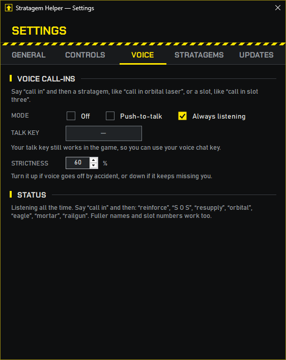

# Stratagem Helper

Call in stratagems in Helldivers 2 with one key, a mouse button, a foot pedal or your voice. It's made for players who find the arrow codes hard on their hands.

  

---

## Why I made it

Every stratagem in Helldivers 2 means holding Ctrl and tapping out a string of arrows, often in a hurry, dozens of times a match. After a while it was really hurting my wrist, so I built this to do the tapping for me.

If you deal with RSI, carpal tunnel, arthritis, a tremor, limited movement or chronic pain, or you play one-handed, I hope it helps you keep diving too.

### What it changes

| Normally | With Stratagem Helper |
| --- | --- |
| Hold Ctrl and tap up to eight arrows, quickly and accurately | Press one key, click a mouse button or tap a foot pedal |
| Use your hands | Say "call in orbital laser" |
| Remember every code for every loadout | It reads your loadout straight off the screen |
| Get the timing right | It puts the code in for you |

The Orbital 380mm Barrage, for example, is Ctrl plus seven arrows. With this it's one press, or none if you use your voice.

---

## What it does

- **Reads your loadout.** Hold Ctrl and press C during a mission, and it picks up your stratagems and their codes.
- **Learns new stratagems by itself.** When a new Warbond comes out, scan once and it's in.
- **Three ways to call in:**
  - **Ctrl + 1–9**: hold Ctrl like normal and press a number.
  - **One key**: no Ctrl at all. It uses the numpad by default, or you can set mouse side buttons or a foot pedal.
  - **Voice**: say "call in" and then the stratagem, like "call in resupply". The "call in" part stops it going off when you're just chatting.
- **Shows your loadout in the corner of the game**, so you know which number is which. You can make it more or less see-through, and Ctrl + V hides it.
- **Counts the keypresses it saves you**, today, this week and all time.
- **Plays a sound** when a scan works or doesn't, so you don't need to look away.
- **Starts with Windows** if you like, and waits in the system tray until you play.
- **Keeps itself up to date**, but only installs updates when you're not playing.

   
  <em>Your loadout (right) next to the game's stratagem menu</em>

---

## The app is accessible too

An accessibility tool should be accessible itself, so:

- **You can use it with just a keyboard.** Tab moves around, the arrow keys pick options, Ctrl + Tab switches between settings tabs, Enter sets a key and Esc closes.
- **It works with screen readers** like Narrator, NVDA and JAWS. Everything is labelled, arrow codes are read out as words ("up, down, right"), and changes like "Got your loadout" are announced.
- **You can make the text bigger** (125%, 150% or 200%) in Settings. It also follows Windows display scaling.
- **It follows Windows High Contrast** and uses your contrast colours.
- **Sound and colour are never the only signal.** Every sound has a message on screen, and every status is spelled out in words.

If something doesn't work for you, please [open an issue](https://github.com/gfyans/Helldivers-2-Stratagem-Helper/issues) and I'll take a look.

---

## Getting started

### What you need

- Windows 10 or 11
- Helldivers 2 in **borderless** or **windowed** mode. Scanning and the overlay need to see the screen; the hotkeys work in any mode.
- For voice: a microphone and English speech recognition in Windows (it comes with English versions of Windows).

### Download

1. Download **`StratagemHelper.exe`** from the [Releases page](https://github.com/gfyans/Helldivers-2-Stratagem-Helper/releases).
2. Put it in a folder of its own. It keeps its settings there.
3. Run it. There's nothing else to install.

> Windows might say it "protected your PC", because the app isn't signed. Click **More info**, then **Run anyway**.

### Your first mission

1. Start Stratagem Helper. The first time, it asks if you want it to start with Windows.
2. Launch Helldivers 2. The light at the bottom of the app turns green.
3. In a mission, **hold Ctrl until the stratagem menu opens, then press C**. You'll hear a blip and see your loadout.
4. Call in with **Ctrl + a number**, **a numpad key on its own**, or **your voice** (turn voice on in Settings).

If the game adds a stratagem partway through (a Hellbomb, say), just scan again.

---

## Using it

### Scanning your loadout

Hold **Ctrl** so the menu opens, then press **C**. Numpad 0 does the same thing without Ctrl. Your stratagems fill the slots in the same order as the game's menu: usually Reinforce, SOS and Resupply, then your four picks.

You'll hear a rising blip if it worked, or a low buzz if it couldn't read the menu. If that happens, hold Ctrl a moment longer before pressing C. You can also pick any slot yourself from the dropdowns.

### Calling in

| How | What to do |
| --- | --- |
| Ctrl + number | Hold Ctrl and press 1–9 |
| One key | Press the slot's key (Numpad 1–9 by default, with Num Lock on) |
| Voice | Say "call in" and the stratagem, or "call in slot three" |

The stratagem ends up in your hand, ready to throw. The numbers stay put even if the game adds a row to its menu mid-match. The overlay always shows what each number does.

### Voice tips

- Say the name as it shows in the app, without the model number: "call in **mortar sentry**", "call in **S O S beacon**". Shorter versions work too, like "call in eagle cluster".
- Push-to-talk is the most reliable. Your talk key still works in the game, so it can be your voice chat key.
- If it goes off by accident, turn up **Strictness**. If it keeps missing you, turn it down.

### Shortcuts (only while you're in the game)

| Keys | What it does |
| --- | --- |
| Ctrl + C | Scan your loadout |
| Ctrl + 1–9 | Call in slot 1–9 |
| Ctrl + V | Hide or show the overlay |
| Numpad 1–9, Numpad 0 | Call in, or scan, without Ctrl |

Ctrl + C and Ctrl + V only do anything while Helldivers 2 is the active window, so copy and paste still work everywhere else.

---

## Settings

Open **Settings** in the app, or right-click the tray icon. Changes take effect straight away.

| Tab | What's there |
| --- | --- |
| **General** | Turn hotkeys on or off, start with Windows, the overlay and how see-through it is, sounds, text size, and input timing |
| **Controls** | Choose your one-key buttons for each slot and for scanning |
| **Voice** | Turn voice on, pick a talk key, and set how strict it is |
| **Stratagems** | Edit or reload the stratagem list |
| **Updates** | Check for updates and turn automatic updates on or off |

  
  

Closing the window sends the app to the system tray. To quit, right-click the tray icon and choose **Exit**.

---

## If something's not working

| Problem | Try this |
| --- | --- |
| "Couldn't read the menu" | Play in borderless or windowed mode with the default HUD size, and hold Ctrl until the menu is fully open. |
| Nothing happens in game | Check the light at the bottom of the app is green. If it is, try running the app as administrator. |
| The wrong stratagem comes out, or inputs get missed | Turn up **Key hold** and **Key gap** in Settings › General. |
| One key misses the first arrow | Turn up **Menu delay** in Settings › Controls. |
| The numpad doesn't work | Turn Num Lock on, or pick different keys in Settings › Controls. |
| Voice says it isn't available | Add English speech recognition in Windows (Settings › Time & language › Speech) and check your microphone. |
| You've moved stratagem inputs to the arrow keys | Choose **Arrow keys** in Settings › General. |

---

## Safety and privacy

- **It never touches the game.** It doesn't read the game's memory or change any files. It looks at the screen, like a screen recorder, and presses keys, like a macro key or a Stream Deck. The overlay is a separate window on top, like Discord's.
- **Anti-cheat:** Helldivers 2 uses Easy Anti-Cheat. I'm not aware of anyone being banned for tools like this, but I can't promise it. Use it at your own risk.
- **It stays on your PC.** No accounts and no tracking. The only time it goes online is to check for updates, and you can switch that off. Voice recognition works offline.
- **Updates are checked before they install**, so only the genuine file from this page gets used.
- **Your settings** are saved in the same folder as the app. Delete the folder and they're gone.

---

## Licence

[MIT](LICENSE): free to use, change and share.

## Disclaimer

Stratagem Helper is an unofficial, fan-made tool. It isn't affiliated with or endorsed by Arrowhead Game Studios or Sony Interactive Entertainment. *Helldivers* is a trademark of its respective owners.
