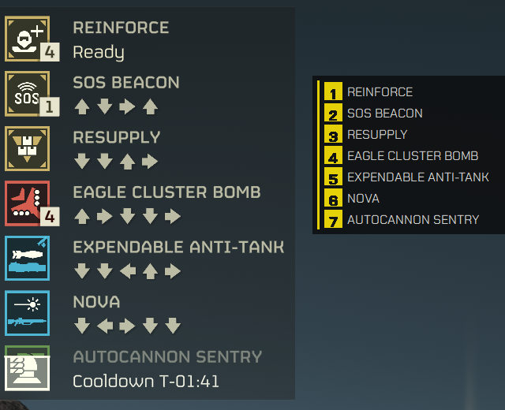

# Stratagem Helper

Call in Helldivers 2 stratagems with a single key, a mouse button, a foot pedal or your voice, instead of holding Ctrl and tapping out arrow codes.

I made it because the arrow codes were wrecking my wrist. If you have RSI, arthritis, a tremor or anything else that makes them hard, or you play one-handed, it might help you too.

  

## Install

Requires Windows 10 or 11, with the game in borderless or windowed mode (scanning and the overlay need to see the screen).

1. Download `StratagemHelper.exe` from [Releases](https://github.com/gfyans/Helldivers-2-Stratagem-Helper/releases).
2. Put it in its own folder. Settings are saved next to it.
3. Run it. If Windows SmartScreen complains, click **More info** → **Run anyway** (the exe isn't signed).

## Usage

**Scan your loadout:** in a mission, hold Ctrl until the stratagem menu opens, then press C (or Numpad 0). You'll hear a blip when it works. Scan again if the game adds a stratagem mid-match. New Warbond stratagems are picked up automatically.

**Call in a stratagem:**

- Ctrl + 1–9
- Numpad 1–9 on its own (or mouse buttons, a foot pedal, etc. — set these in Settings › Call-ins)
- Voice: say "call in" followed by enough of the name to identify it, e.g. "call in eagle" if you only have one eagle, or "call in slot three". Turn it on in Settings › Call-ins. If a phrase could match two stratagems it does nothing. The Call-ins tab shows the shortest phrase for each slot.

A small overlay in the corner of the game shows which number is which. Ctrl + V hides it.

Ctrl + C and Ctrl + V are only intercepted while Helldivers 2 is focused, so copy/paste still works elsewhere. If you've rebound the stratagem menu or direction keys in game, set the same keys in Settings › Controls.

  

## Troubleshooting

| Problem | Fix |
| --- | --- |
| "Couldn't read the menu" | Use borderless/windowed with the default HUD size, and hold Ctrl until the menu is fully open. |
| Nothing happens in game | Check the status light at the bottom of the app is green. If it is, try running as administrator. |
| Wrong stratagem or missed inputs | Increase **Key hold** and **Key gap** in Settings › Controls. |
| One-key call-ins miss the first arrow | Increase **Menu delay** in Settings › Call-ins. |
| Numpad does nothing | Turn Num Lock on. |
| Voice unavailable | Install English speech recognition in Windows (Settings › Time & language › Speech). |

## Is it safe?

It doesn't read game memory or modify any game files. It reads the screen and sends key presses, the same as a macro key or Stream Deck. That said, Helldivers 2 uses Easy Anti-Cheat and I can't guarantee anything, so use it at your own risk.

Nothing leaves your PC except the update check, which can be turned off. Voice recognition runs offline.

## Licence

[MIT](LICENSE). Unofficial fan project, not affiliated with Arrowhead Game Studios or Sony Interactive Entertainment.
