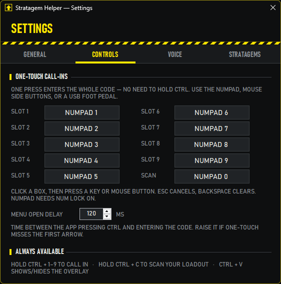

# Stratagem Helper

**An accessibility companion for Helldivers 2.** Call in stratagems with a single key, a mouse button, a foot pedal or your voice, instead of holding Ctrl and tapping out long arrow sequences.

<p align="center">
  
</p>

---

## Why this exists

Helldivers 2 is built around stratagems, and every call-in is a quick, precise input: **hold Ctrl and tap a 3–8 key directional code**, often under pressure, dozens of times a match. Over a session that adds up to many hundreds of fast, repetitive keypresses from the same hand.

This app was made because entering those codes was **straining my wrist**. It takes over the repetitive part, so you can keep playing the game you enjoy with far less physical effort.

### Who it can help

- Players with **repetitive strain injury (RSI)**, **carpal tunnel**, **tendonitis** or **arthritis**
- Players with **limited hand mobility, strength or dexterity**, or a **tremor**
- **One-handed** players, or anyone who finds holding one key while sequencing others hard
- Players managing **chronic pain or fatigue**, who want shorter, gentler inputs
- Anyone who finds **memorising dozens of codes** a barrier

### How it reduces strain

| Instead of… | You can… |
| --- | --- |
| Holding Ctrl **and** tapping up to 8 arrows quickly and accurately | Press **one key**: numpad, mouse side button or **USB foot pedal** |
| Using your hands at all | Say **"call in orbital laser"** (fully offline voice control) |
| Memorising every code, which changes with each loadout | Let the app **read your loadout from the screen** and learn codes automatically |
| Fast, precisely timed inputs | Let the app type the code at a steady, **adjustable** speed |
| Guessing whether it's helping | Watch the **keypresses-saved** counter go up |

For example, the Orbital 380mm HE Barrage is Ctrl + 7 arrows. With one-touch that's **one press**; by voice it's **zero**.

---

## Features

- **Loadout scanning.** Hold Ctrl, press **C**, and the app reads your stratagems straight off the in-game menu (names *and* arrow codes). It only looks at screen pixels.
- **Learns new stratagems by itself.** New Warbond stratagem? The app reads its code from the arrows on screen and remembers it. No update needed.
- **Three ways to call in:**
  - **Ctrl + 1–9**: hold Ctrl as usual, press a number, and the code is entered for you.
  - **One-touch**: a single key with no Ctrl needed. Numpad by default; rebind to **mouse side buttons, middle mouse or a foot pedal**.
  - **Voice**: say **"call in"** plus a name or slot ("call in resupply", "call in slot three"). Push-to-talk or always-listening, using the offline Windows speech recogniser. The "call in" keyword stops chat from triggering anything by accident.
- **In-game loadout overlay.** A small panel in the top-left corner shows which number is which stratagem, without opening the menu. It moves aside when the menu opens, **Ctrl + V** hides it, and your next scan brings it back.
- **Keypresses saved.** Today, last 7 days and all-time totals, so you can see the strain you're avoiding.
- **Chimes, not menus.** Audio cues confirm a scan worked (or didn't), so you don't need to look away from the game.
- **Set and forget.** Optional *Start with Windows*: it sits in the system tray and only acts while Helldivers 2 is the active window. A status light shows **🔴 Disabled · 🟠 Waiting for Helldivers 2 · 🟢 Ready**.
- **Adjustable timing** for key hold, gap and menu-open delay, so it suits your PC and connection.

<p align="center">
  <br>
  <em>The loadout overlay (right) beside the game's stratagem menu</em>
</p>

---

## Getting started

### Requirements

- **Windows 10 (20H1 or later) or Windows 11**
- **Helldivers 2 in Borderless or Windowed mode.** Loadout scanning and the overlay read and draw on the screen, which exclusive fullscreen blocks. Hotkeys work in any mode.
- **For voice:** a microphone and an **English** Windows speech recogniser (installed with English versions of Windows; otherwise add one under *Settings › Time & language › Speech*).

### Option 1: Download (recommended)

1. Go to the [**Releases**](https://github.com/gfyans/Helldivers-2-Strategem-Helper/releases) page and download **`StratagemHelper.exe`**.
2. Put it in a folder of its own (for example `Documents\Stratagem Helper`). It saves its settings next to itself.
3. Double-click it. Nothing else to install: .NET is built in.

> **Windows SmartScreen** may say it "protected your PC", because the app isn't code-signed. Click **More info › Run anyway**. You can always build it yourself from source instead (below).

### Option 2: Build from source

Install the [.NET 10 SDK](https://dotnet.microsoft.com/download), then:

```bash
git clone https://github.com/gfyans/Helldivers-2-Strategem-Helper.git
cd Helldivers-2-Strategem-Helper
dotnet run --project StratagemHelper -c Release
```

To make your own single-file `StratagemHelper.exe` (no .NET needed on the target PC):

```bash
dotnet publish StratagemHelper -c Release -r win-x64 --self-contained true -p:PublishSingleFile=true -p:IncludeNativeLibrariesForSelfExtract=true -p:EnableCompressionInSingleFile=true -o publish
```

Or open `StratagemHelper.sln` in Visual Studio 2022 and press F5.

### First match: quick start

1. Start Stratagem Helper (it can live in the system tray), then launch Helldivers 2. The status light turns **green**.
2. At the start of a mission, **hold Ctrl until the stratagem menu opens, then press C.** You'll hear a chime and your loadout appears in the app and the overlay.
3. Call in stratagems:
   - **Ctrl + number**, or
   - **Numpad 1–9** on its own (one-touch), or
   - **"call in …"** by voice (turn it on under *Settings › Voice*).
4. If the game adds a stratagem mid-mission (a Hellbomb, say), press **Ctrl + C** again.

---

## Using it

### Scanning your loadout

Hold **Ctrl** (the stratagem menu opens), then press **C**. Your one-touch scan key (default **Numpad 0**) does the same without needing Ctrl. Slots fill in the order of the in-game menu: usually 1 Reinforce, 2 SOS, 3 Resupply, then your four picks, then any mission stratagems.

- A **chime** means it worked; an **error beep** means it couldn't read the menu (hold Ctrl until it's fully open and try again).
- Stratagems it doesn't know are **learned from the arrows on screen**. Codes that differ from its list (after a game patch, say) are corrected from the screen.
- You can also pick any slot by hand from the dropdowns.

### Calling in

| Method | How | Ctrl needed? |
| --- | --- | --- |
| Ctrl + number | Hold Ctrl, press 1–9 | Yes (you hold it) |
| One-touch | Press the slot's bound key or button (default Numpad 1–9, Num Lock on) | No, the app presses it |
| Voice | Say **"call in"** + stratagem name, or "call in slot one" to "slot nine" | No |

After the code goes in, the stratagem is in your hand: throw it as normal. Your numbers follow your **last scan**, so a row the game adds mid-match (such as Eagle Rearm) won't shift them. The overlay always shows what each number does.

### Voice tips

- Say names as they appear in the app, without the model numbers: "call in **mortar sentry**", "call in **eagle five hundred kilogram bomb**", "call in **S O S beacon**". Short forms work too ("call in eagle cluster").
- *Push-to-talk* (bind any key or mouse button) is the most reliable. The key still reaches the game, so it can double as your in-game voice chat key.
- If it triggers when you don't want it to, raise **Min. confidence**; if it ignores you, lower it.

### Keyboard shortcuts (only while Helldivers 2 is focused)

| Keys | Action |
| --- | --- |
| Ctrl + C | Scan loadout |
| Ctrl + 1–9 | Call in slot 1–9 |
| Ctrl + V | Hide / show the overlay |
| Numpad 1–9 / Numpad 0 | One-touch call-in / scan (rebindable) |

Ctrl + C and Ctrl + V **only** act while the game is the active window, so copy and paste work normally everywhere else.

---

## Settings

Open **⚙ Settings** in the app (or right-click the tray icon). Changes apply instantly.

| Tab | What's there |
| --- | --- |
| **General** | Enable/disable hotkeys · Ctrl+C scanning · only when Helldivers 2 is focused · loadout overlay · Start with Windows · WASD or arrow keys · key hold and gap timing |
| **Controls** | One-touch bindings for slots 1–9 and scan (click a box, press a key/button; Esc cancels, Backspace clears) · menu-open delay |
| **Voice** | Off / push-to-talk / always listening · push-to-talk key · minimum confidence · what it's listening for |
| **Stratagems** | How many stratagems it knows · edit or reload the list |

<p align="center">
  
  
</p>

Closing the window sends the app to the system tray. Right-click the tray icon and choose **Exit** to quit.

---

## Troubleshooting

| Problem | Try |
| --- | --- |
| "Couldn't read the stratagem menu" | Use Borderless/Windowed mode, keep the default HUD scale, and hold Ctrl until the menu is fully open before pressing C. Scanning was tuned at 2560×1440 (16:9). |
| Nothing happens in game | Check the status light is green. Try running Stratagem Helper as administrator. |
| Wrong stratagem, or inputs dropped | Raise **key hold** and **key gap** (Settings › General) to ~50 ms. |
| One-touch misses the first arrow | Raise **menu-open delay** (Settings › Controls). |
| Numpad keys don't work | Turn **Num Lock** on, or rebind under Settings › Controls. |
| Voice says it's unavailable | Install an English speech recogniser (Windows *Settings › Time & language › Speech*) and check your default microphone. |
| You've rebound stratagem directions to arrow keys | Choose **Arrow keys** under Settings › General. |

---

## Fair play, safety and privacy

- **Never touches the game.** It doesn't read game memory, inject anything, or modify files. It looks at screen pixels (like a screen recorder) and sends ordinary keyboard input (like a macro key or a Stream Deck). The overlay is a separate window on top, like Discord's or Steam's.
- **Anti-cheat:** Helldivers 2 uses GameGuard. Input tools like this are widely used and I'm not aware of anyone being banned for them, but there's no guarantee. **Use at your own risk.**
- **Fully local.** No internet connection, accounts or telemetry. Voice recognition runs offline in Windows. Screen captures are processed in memory and never saved.
- **Your data** (`settings.json`, `stratagems.json`, `stats.json`) lives next to the exe. Delete the folder and it's gone.

---

## For developers

```
StratagemHelper/      the app (C#, .NET 10, WinForms)
  MenuReader.cs       screen capture, Windows OCR, arrow recognition
  KeyboardHook.cs     global keyboard/mouse hooks and bindings
  InputSender.cs      scan-code input (what the game sees)
  Voice.cs            offline speech grammar ("call in" + loadout)
  LoadoutOverlay.cs   click-through in-game panel
tools/OcrTest/        test tool for the app's detection, voice and input code
tools/capture-on-ctrl.ps1   saves a screenshot each time Ctrl is held (to collect menu samples)
```

The test tool runs the app's real code:

```bash
cd tools/OcrTest
dotnet run -c Release -- ../../captures/*.png   # menu reading (names + arrows) on your captures
dotnet run -c Release -- --voice                # voice phrases against the real recogniser
dotnet run -c Release -- --keys                 # one-touch keystroke order
dotnet run -c Release -- --overlay              # shows a sample loadout overlay
```

`captures/` isn't in the repo (game screenshots can show your in-game name). Run `tools/capture-on-ctrl.ps1`, then hold Ctrl in a match to collect your own.

Contributions are welcome, especially support for other resolutions, HUD scales and languages.

---

## Disclaimer

Stratagem Helper is an unofficial, fan-made accessibility tool. It is not affiliated with or endorsed by Arrowhead Game Studios or Sony Interactive Entertainment. *Helldivers* is a trademark of its respective owners.
